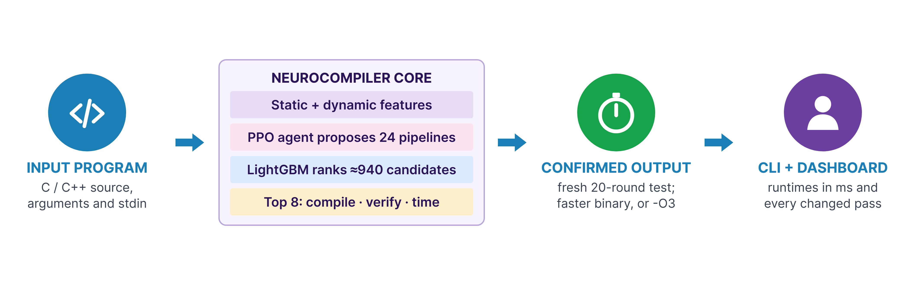
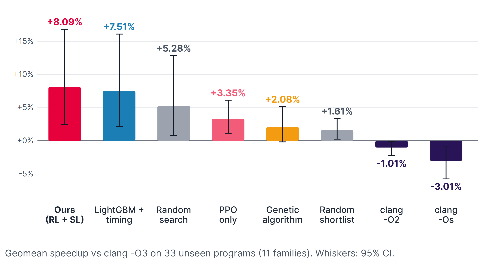
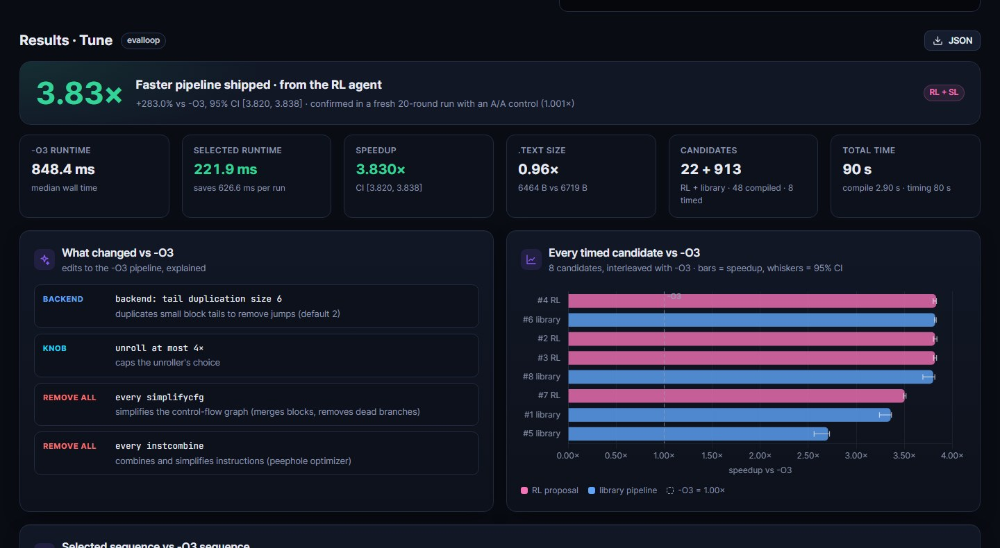
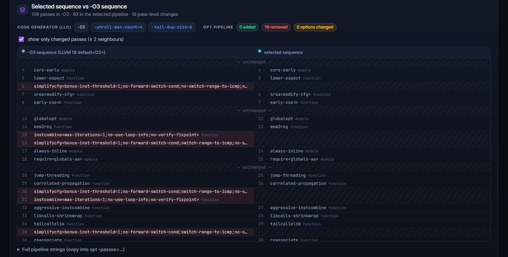
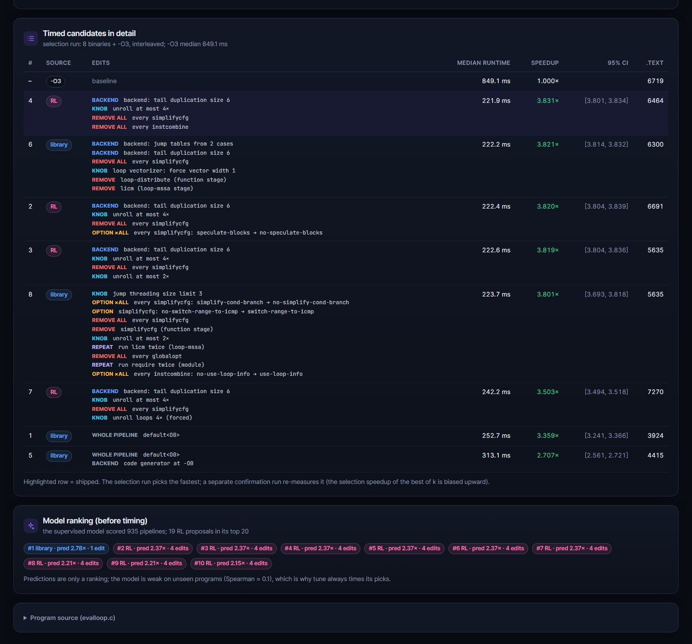

# How to use this handbook

This handbook is for the NeuroCompiler team. It collects what we built, why, how it works, every result, what didn't
work, and where each number comes from. Use it as the source for the report, synopsis, presentation, poster, viva
answers and any other document.

**Rules for using these numbers.** These come from our project rules, and examiners will check them:

- **Quote the averages twice.** Always give the average gain with and without the largest single result: +8.09%, and +4.92% without the largest.
- **State RL's effect.** Its measured effect is +0.2%, which is not significant. An RL proposal shipped on 1 of 33 test programs.
- **Label the 3.83× demo.** It is a best-case demonstration on a validation program, not part of the test result.
- **Label every number.** Say whether it is measured, calculated, simulated, predicted or external. Don't present a prediction or plan as a result.
- **Never claim deployment.** Nothing has been deployed in production.
- **Keep the misses.** Don't drop the gates we missed. Report them together with the decisions taken.

**Team.**

| Name | USN |
|---|---|
| Chirag S | 1JS23CS039 |
| Dhanush Singh | 1JS23CS048 |
| Gagan S Shamnur | 1JS23CS052 |
| Nithin Choudhary A | 1JS23CS101 |

Guide: Dr. P.B. Mallikarjuna, Professor. HOD: Dr. Prabhudev Jagadeesh M P, Professor & Head. Principal: Dr. Bhimasen
Soragaon. Department of Computer Science & Engineering, JSS Academy of Technical Education, Bengaluru (VTU),
academic year 2026-27. The project co-ordinator's name and designation are still to be filled in.

**Full project title.** NeuroCompiler: Hybrid Machine Learning and Reinforcement Learning Guided LLVM Pass Selection for
Runtime Optimization.

# Numbers to quote (cheat sheet)

| What | Value | Type |
|---|---|---|
| Average speed-up over -O3 on 33 unseen test programs (final RL + SL) | **+8.09%** (95% CI +2.44% to +16.84%) | Measured |
| Same, without the single largest result | **+4.92%** | Measured |
| Test programs measurably slower than -O3 | **0 of 33** | Measured |
| Test programs at least 5% faster | **9 of 33** (27%) | Measured |
| Test programs that kept -O3 | 21 of 33 (median program 1.00×) | Measured |
| Largest single win on the test set | polybench/durbin 2.81× | Measured |
| LightGBM shortlist + timing, without RL | +7.51%, +4.30% without the largest | Measured |
| Extra gain from RL over LightGBM alone | +0.2% (CI −0.2% to +0.7%), not significant | Measured |
| Best demo (interpreter loop, validation program) | 848.4 ms → 221.9 ms, 3.83× | Measured |
| Steps in LLVM 18's -O3 pipeline | 109 (76 distinct passes) | Measured |
| Programs in the corpus | 146 usable of 347 scanned, 35 families | Measured |
| Candidate pipelines recorded | 70,409 (19,534 timing measurements) | Measured |
| Correlation between IR size change and speed | ρ = −0.08 over 18,637 candidates | Measured |
| Timing uncertainty (selftest) | 0.12% CI half-width, 0.01% A/A bias | Measured |
| Headroom found by a wide search (116 never-searched programs) | +15.6% geomean, 54/115 programs at least 5% faster | Measured |
| Compile-only predict mode | +0.64% (CI includes 0), so it ships as advice only | Measured |
| Median time to tune one program | about 139 s | Measured |

Rounded versions, for slides and the video: "about 8% faster on average", "about 5% without the biggest win", "none
measurably slower", "850 ms to 220 ms".

# 1. Summary

## 1.1 In one sentence

NeuroCompiler finds a faster LLVM optimization pipeline for each individual C/C++ program: machine-learning models
shortlist candidate pipelines, and real, carefully controlled timing decides which one ships, with -O3 as the fallback.

## 1.2 Abstract (report-ready)

Compilers optimize every program with the same fixed sequence of transformations. LLVM's -O3 runs 109 pass steps in
one order regardless of what the program does, although the best sequence differs from program to program.
NeuroCompiler is a per-program pass-pipeline tuner for LLVM 18. A pipeline is represented as a short list of edits to
the -O3 pipeline. A reinforcement-learning agent (PPO) proposes candidate pipelines, a LightGBM surrogate model ranks
them together with a library of about 900 previously successful pipelines, and the top eight are compiled, checked
against the unoptimized program's output, and timed against -O3 in interleaved, pinned measurements with an
identical-binary control. A candidate ships only if it wins again in a fresh confirmation run; otherwise -O3 ships.
The models were trained on 146 real benchmark programs (70,409 candidate pipelines) and evaluated once on 33 programs
from 11 program families never used in training. On these, NeuroCompiler is 8.09% faster than -O3 on average (95% CI
+2.44% to +16.84%; +4.92% excluding the largest result), with 9 programs at least 5% faster and none measurably
slower. The results also show the limits of prediction alone: the models rank pipelines only slightly better than
chance on unseen programs, picking without timing made 16 of 33 programs slower, and the reinforcement-learning agent
added only +0.2% (not significant). Measurement, not prediction, makes per-program tuning reliable.

**Keywords:** compiler optimization, LLVM, pass ordering, phase ordering, autotuning, LightGBM, reinforcement
learning, PPO, performance measurement.

## 1.3 60-second explanation

-O3 gives every program the same 109-step recipe. That's a good default, but not the best recipe for every program. NeuroCompiler
finds a faster one for each program without changing the source code. An AI agent proposes recipes, a second model
ranks them, and real timing decides: if a recipe can't prove itself twice, you keep -O3. On 33 programs it had never
seen, it ran 8% faster on average, about 5% without its biggest win, and none got measurably slower.

## 1.4 The one idea to remember

**Models shortlist. The stopwatch decides.** No model is trusted to pick the answer. The models are only used to
choose a few candidates worth timing.

# 2. Introduction

## 2.1 Background

A compiler such as clang translates C/C++ source into machine code in stages. The front end produces LLVM IR
(intermediate representation), the optimizer (`opt`) applies a sequence of optimization *passes* to the IR, and the
back end (`llc`) turns the optimized IR into machine code. Each pass is one transformation, for example inlining
functions, unrolling loops, vectorizing with SIMD instructions, or simplifying the control-flow graph. The standard
optimization levels (-O1, -O2, -O3, -Os) are fixed pass sequences chosen by compiler experts to work well *on
average*.

Choosing which passes to run and in which order is called the **phase-ordering problem**. It has been studied for
decades, because passes interact: one pass can create or destroy opportunities for another (Ashouri et al., 2018).

## 2.2 Motivation

- **One fixed recipe.** LLVM 18's -O3 is 109 pass steps (76 distinct passes; `simplifycfg` and `instcombine` run 8 times
  each), in the same order for every program.
- **No universal best.** In our knowledge base, `-force-vector-width=8` ranged from 0.83× to 6.59× across 31 programs, and
  `-unroll-count=2` was confirmed faster on 4 programs and slower on 6.
- **Compute is paid on every run.** Industry treats a few percent as worth deploying. Google deployed ML-guided register
  allocation for 0.3–1.5% more queries per second (MLGO), and its AutoFDO paper reported 10.5% from profile-guided
  optimization. Those are other projects' numbers, quoted for context.

## 2.3 Lessons from an earlier attempt

An earlier version of this project optimized proxy metrics, IR instruction count and binary size. Those improved, but
runtime did not. Across 18,637 measured candidates, the change in IR instruction count and the change in runtime are
essentially uncorrelated (Spearman ρ = −0.08), and candidates with more than 1% fewer IR instructions were faster only
57% of the time. This project therefore judges **only measured runtime**. Size and compile time are constraints only.

# 3. Problem statement, objectives and scope

## 3.1 Problem statement

Given a C/C++ program, find an LLVM optimization pipeline that makes *that program* run measurably faster than
`clang -O3` on the target machine, without changing its source code or its output. Prove the gain with
statistically controlled measurement, and never ship a pipeline that is slower than -O3 beyond noise.

## 3.2 Objectives

1. Build a timing harness precise to well under 1%, with built-in checks of its own accuracy.
2. Build a corpus of real benchmark programs, verified for correctness and timing stability, split by program family.
3. Represent pipelines in a form that is valid by construction and transferable between programs.
4. Collect a dataset of measured pipelines and train models that shortlist promising candidates (LightGBM surrogate,
   PPO agent).
5. Beat -O3 on unseen programs, with identical output and no regressions, and compare fairly against baselines
   (random search, genetic algorithm, -O2, -Os).
6. Deliver a usable tool: a command-line interface and a live web dashboard.

## 3.3 Success criteria (fixed before the results)

| Tier | Requirement | Achieved? |
|---|---|---|
| Minimum | No regressions or miscompiles | Yes in the final configuration (0/33 slower). The first SL-only run had one regression (lencod 0.979×), which led to the confirmation step |
| Good | Geomean +2–4% with CI excluding 0, and ≥ 20–30% of programs ≥ +5% | **Yes**: +4.92% excluding the largest, CI excludes 0, 27% of programs ≥ +5% |
| Strong | Geomean ≥ +5% | Only with the largest result included (+8.09%) |

Binary `.text` size should stay within about 1.10× of -O3 (soft penalty `size_cap`).

## 3.4 Scope and assumptions

- C and C++ programs, single-threaded, deterministic, CPU-bound, with visible output, running 0.35–2.9 s at -O3.
- One machine: AMD Ryzen 9 270 (Zen 4, AVX-512) under Windows WSL2, LLVM pinned to 18.1.8.
- Correctness is checked by comparing the program's output hash with the -O0 build on the given input.
- Out of scope: multi-threaded programs, I/O-bound services, per-function tuning, other compilers, other CPUs.

# 4. Literature survey and related work

| Work | What it does | How NeuroCompiler relates |
|---|---|---|
| Ashouri et al., *A Survey on Compiler Autotuning using Machine Learning*, ACM CSUR 2018 | Surveys more than 200 papers on ML for optimization selection and phase ordering | Frames our problem. We follow its split between selection and ordering, and use edits over -O3 |
| Trofin et al., *MLGO*, 2021 (Google) | RL-trained policies replace LLVM heuristics for inlining (size) and register allocation (speed). Deployed: 0.3–1.5% QPS | Shows ML in production LLVM. MLGO replaces one decision inside a pass; we change the whole pipeline per program and verify by timing |
| Chen et al., *AutoFDO*, CGO 2016 (Google) | Uses sampled runtime profiles for feedback-directed optimization; 10.5% geomean on their benchmarks | Complementary: profile data improves decisions within passes. We don't use profiles, and combining both is future work |
| Panchenko et al., *BOLT*, CGO 2019 (Meta) | Post-link binary layout optimizer; up to 8% on top of PGO and LTO | Complementary, working after linking. Could be applied after our pipeline |
| Mytkowicz et al., *Producing Wrong Data Without Doing Anything Obviously Wrong!*, ASPLOS 2009 | Shows that harmless setup changes (environment size, link order) bias benchmark results | Motivates our harness: interleaving, pinning, ASLR off, A/A control, layout test |
| Kanev et al., *Profiling a Warehouse-Scale Computer*, ISCA 2015 | Profiles 20,000+ Google machines; finds that shared low-level code takes a large share of cycles | Context: why small gains in compiled code matter at scale |
| Elhage, *Performance of the Python 3.14 tail-call interpreter*, 2025 | Found that a Clang 19 change merged CPython's interpreter dispatch (332 → 3 indirect jumps), about 9–12% slower | The same class of problem as our interpreter demo |
| PolyBench/C 4.2.1, LLVM test-suite | Standard benchmark programs | Our corpus |

**Research gap we address.** Most ML-for-compiler work reports model accuracy or gains on programs similar to the
training data, often judged by proxies such as code size or IR count. NeuroCompiler judges runtime only, evaluates on
program families never seen in training, and uses a measurement protocol strict enough to separate real gains from
noise. It also reports where ML did *not* help.

# 5. System requirements

**Hardware used.** AMD Ryzen 9 270 (8 cores / 16 threads). WSL2 configured with 14 vCPUs and 10 GB of RAM. Timing is pinned
to vCPU 6. Parallel phases use vCPUs 2, 6 and 10, after a multi-core A/A test.

**Software.**

| Component | Version / note |
|---|---|
| OS | Windows 11 + WSL2 Ubuntu |
| Compiler | LLVM/Clang 18.1.8, pinned at `/usr/lib/llvm-18/bin`. The OS default, LLVM 21, is never used for data |
| Language | Python 3.14 (virtual environment `.venv`) |
| ML | LightGBM, scikit-learn, NumPy, SciPy. PPO is written from scratch in NumPy, with no PyTorch |
| Storage | SQLite (`results/dataset.sqlite`, `results/predict.sqlite`, `results/deploy.sqlite`) |
| Web | FastAPI + uvicorn (dashboard on `localhost:8000`) |
| Simulation | Valgrind cachegrind (simulated cache and branch features; no hardware counters under WSL2) |
| Benchmarks | PolyBench/C 4.2.1, LLVM test-suite SingleSource and MultiSource |

# 6. System design and architecture

## 6.1 Overview

The system has an **offline lab**, where the knowledge is built over hours to days, and an **online tool**, which tunes a
new program in a few minutes.



**Offline lab:**

1. **Corpus** (`nc/corpus.py`, `nc/msource.py`). Fetch PolyBench and the LLVM test-suite, filter programs, freeze the split.
2. **Build** (`nc/toolchain.py`). `clang -O3 -Xclang -disable-llvm-passes` → `opt -passes=<pipeline>` → `llc` → link. Binaries are cached by optimized-IR hash, so identical IR is never timed twice.
3. **Timing** (`nc/timing.py`). A pinned, interleaved runner with paired bootstrap confidence intervals, an output check and a quiet guard.
4. **Search** (`nc/search.py`). Random, evolutionary and level-seed searches over pipeline edits, with confirmation, pass minimization and validation.
5. **Knowledge base** (`nc/passkb.py`). Single edits measured one by one on winning programs.
6. **Dataset** (`nc/db.py`, `nc/collect.py`). All candidates and measurements in SQLite, with a data-quality report.
7. **Features** (`nc/features.py`, `nc/remarks.py`). Program and pipeline features.
8. **Models** (`nc/model.py`, `nc/rl.py`). The LightGBM surrogate and the PPO policy, frozen and hash-checked (`nc/tunelock.py`).

**Online tool** (`nc/deploy.py`, `bin/neurocompiler`):

1. Your source.
2. Features.
3. PPO proposes.
4. LightGBM ranks.
5. Compile and verify.
6. Time against -O3 and confirm.
7. Binary plus a JSON proof report, or the -O3 fallback.

## 6.2 Module reference

| Module | Lines | Responsibility |
|---|---|---|
| `nc/toolchain.py` | 301 | Compile with any pipeline, single or multi-file, C or C++; IR-hash dedup; llc flags |
| `nc/timing.py` | 517 | Pinned, interleaved runner; bootstrap CIs; correctness check; quiet guard; SMT-sibling option |
| `nc/envcheck.py` | 91 | Environment report and warnings |
| `nc/corpus.py` | 518 | Fetch suites, prescan, scan with quality filters, frozen split, report |
| `nc/msource.py` | 220 | LLVM test-suite MultiSource adapter (a small CMake interpreter) |
| `nc/pipeline.py` | 452 | -O3 pass tree, edit genome, mutation operators, action spaces v1 and v2 |
| `nc/search.py` | 829 | Search methods, merged confirmation, minimization, validation, report |
| `nc/passkb.py` | 195 | Per-pass knowledge base: leave-one-out, option flips, family edits, add-one, knobs |
| `nc/collect.py` | 107 | Data collection driver, data-quality report, dataset version tag |
| `nc/features.py` | 386 | Static IR features, simulated (cachegrind) features, scan facts, genome encoding |
| `nc/remarks.py` | 160 | LLVM optimization-remark features (predict mode) |
| `nc/model.py` | 287 | LightGBM surrogate (regressor + lambdarank), leave-one-family-out CV, gate 7B |
| `nc/rl.py` | 237 | PPO over macro-actions with surrogate reward, in NumPy |
| `nc/deploy.py` | 238 | Tune mode: top-k loop with confirmation and -O3 fallback |
| `nc/predict.py` | 722 | Predict mode: compile-only recommendation with ensemble, harm classifier and gate |
| `nc/evaluate.py` | 302 | Frozen-test evaluation of all methods and baselines, report, reproduction run |
| `nc/parallel.py` | 270 | Parallel timing workers on separate cores |
| `nc/tunelock.py` | 73 | Freezes tune mode's models and library with SHA-256 hashes |
| `nc/db.py` | 72 | SQLite measurement store |
| `nc/cli.py` | 861 | Command-line entry point for all phases |
| `dashboard/server.py` |   | FastAPI web app: job queue, streaming logs, saved runs, pipeline diff, research page |

About 6,900 lines of Python in `nc/`, plus the dashboard.

## 6.3 Data flow of one tune run

1. Build the program at -O0 and run it. Its output hash becomes the reference every candidate must match.
2. Extract program features: static IR counts, plus a quick timed scan of -O0, -O1, -O2, -O3 and -Os.
3. Load the frozen LightGBM model and PPO policy. Tune refuses to run if any file hash changed.
4. Build the candidate library of 913 pipelines: pruned knowledge-base edits, pipelines that won on training programs, standard-level seeds, and 300 random genomes.
5. PPO proposes up to 24 pipelines (3 × k, k = 8), which are pooled with the library (about 935 in total).
6. LightGBM scores every pipeline in the pool.
7. In ranked order, compile in batches until 8 distinct binaries exist whose output matches -O0. Binaries identical to -O3 are skipped.
8. Time the 8 candidates together with -O3, in 10 shuffled, interleaved rounds on one pinned core.
9. Take the fastest candidate whose CI lower bound is above 1.0. Re-time it in a fresh 20-round run, together with -O3 and a byte-identical copy of -O3 as an A/A control.
10. Ship it only if the fresh CI lower bound is above 1.01 and the control reads within 1% of 1.00. Otherwise copy the -O3 binary.
11. Write the binary, plus a JSON report covering the shipped pipeline, its source (RL or library), every timed candidate, and the timings.

Median cost on the test set is about 139 s per program, including about 78 extra compiles.

# 7. Methodology (detailed)

## 7.1 Pipeline representation: the genome

The -O3 pipeline printed by `opt -print-pipeline-passes` is parsed into a tree, for example
`function<eager-inv>(simplifycfg<…>, sroa<…>, loop-mssa(licm<…>, …), …)`. Every leaf has a stable id. A **genome**
is a list of edits that reference those ids. An empty genome is exactly -O3.

**Edit operations, action space v1:** `del(id)`, `dup(id)`, `swap(id)`, `ins(after, pass, ctx)`,
`knob(name, value)` and `backend(level)`. Six optimizer knobs are included, such as `-inline-threshold`, `-unroll-count`
and `-force-vector-width`.

**Action space v2** adds:

- `param(id, tok, new)`: flip one option of one pass instance, for example simplifycfg's `sink-common-insts`.
- `param_all(pass, tok, new)`: flip that option on every instance of the pass.
- `del_all(pass)`: delete every instance of a pass.
- More optimizer knobs, llc back-end flags (tail duplication, tail merging, loop alignment, cmov conversion,
  scheduling, jump tables), and more insertable passes such as `dfa-jump-threading` and `gvn-sink`.

**Why this representation?**

- **Valid by construction.** Inserted passes come from the same nesting context (module, CGSCC, function or loop), so the result is always a legal pipeline.
- **Portable.** Edits refer to -O3 steps, so a pipeline found on one program can be tried on another.
- **Explainable.** Removing one edit and re-timing shows what mattered. This is pass minimization.

## 7.2 Measurement harness

- **Pinned core.** Benchmarks run on vCPU 6; the harness runs elsewhere.
- **Randomized interleaving.** Each round runs every binary once, in shuffled order, so slow drift affects all candidates equally.
- **Paired statistics.** Speed-up is computed round by round against -O3, with a 4,000-sample bootstrap 95% CI.
- **Settings.** 30 rounds for confirmation, 5 warm-up rounds discarded, 3 s busy settle, ASLR disabled for the benchmark process.
- **A/A control.** A byte-identical copy of -O3, at a different path, is timed as if it were a candidate and must read 1.00× within 1%. Otherwise the run is repeated and flagged.
- **Output check.** Every run's output hash must equal the -O0 reference. A mismatch disqualifies the candidate.
- **Quiet guard.** Because the laptop is shared, timing waits while other sessions use more than 0.6 cores, for up to 30 minutes.
- **Screening economy.** Search uses successive halving: 1 round for everyone, then 2 more if the speed-up is at least 0.98. Runs slower than 1.3× -O3 are killed. Screening numbers are never reported as results.
- **Winner's curse control.** The best of several confirmed candidates is re-measured in a fresh, independent validation run. Gates use the validated numbers.
- **Parallel timing.** Allowed only for core sets that passed a multi-core A/A test. Three cores (2, 6, 10) passed, with bias ≤ 0.46%, noise similar to serial, and known speed-ups within 0.2%. Five cores kept speed-ups unbiased but made noise 5–40× larger, so they were rejected. At most one memory-heavy program runs at a time. All final numbers are re-measured serially.
- **Selftest.** Run after moving to 14 vCPUs: PASS, with CI half-width 0.12%, A/A bias 0.01%, drift 0.03% and -O0/-O3 gap 3.40×.
- **Layout randomization.** Tested and gave no benefit (`results/layout_test_20261023-102201.json`), so it is not used.

## 7.3 Corpus and dataset

Sources: PolyBench/C 4.2.1 (dimensions scaled), LLVM test-suite SingleSource (C and C++, argv-scaled where
possible) and MultiSource (multi-file programs compiled per file and `llvm-link`ed into one module, so -O3 and every
candidate see the whole program).

A program is kept only if it builds at -O0, -O1, -O2, -O3 and -Os, gives identical output at every level (the -O0 output is the
reference), is deterministic, and its -O3 runtime lies between 0.35 s and 3.0 s on this machine.

| Funnel | Count |
|---|---|
| Programs scanned | 347 |
| Usable | **146** in 35 families |
| By suite | PolyBench 30, SingleSource 41, MultiSource 75 |

| Rejection reason | Programs |
|---|---|
| too_fast | 130 |
| no_output | 25 |
| build_fail | 22 |
| unsupported | 10 |
| run_nonzero_exit | 6 |
| too_slow | 3 |
| output_mismatch | 3 |
| run_timeout | 2 |

**Split by family**, frozen on 2026-10-24 (seed 0) before any modelling: train 91 programs
(19 families), validation 22 (5 families), test
33 (11 families). A family enters test or validation only if it fits the remaining budget
(TSVC, with 33 programs, goes to train).

- **Test families:** ms/Applications/JM, ms/Applications/aha, ms/Applications/siod, ms/BitBench, ms/NPB-serial, ms/Ptrdist, ms/VersaBench, polybench/linear-algebra/kernels, polybench/linear-algebra/solvers, polybench/medley, ss/Shootout-C++
- **Validation families:** ms/ASC_Sequoia, ms/Applications/obsequi, ms/Benchmarks/Fhourstones-3.1, polybench/stencils, ss/Misc
- **Train families:** ms/Applications/SIBsim4, ms/Applications/SPASS, ms/Applications/minisat, ms/Benchmarks/llubenchmark, ms/Benchmarks/nbench, ms/Benchmarks/sim, ms/DOE-ProxyApps-C, ms/DOE-ProxyApps-C++, ms/MallocBench, ms/Olden, ms/TSVC, ms/Trimaran, polybench/datamining, polybench/linear-algebra/blas, ss/BenchmarkGame, ss/CoyoteBench, ss/McGill, ss/Misc-C++, ss/Shootout

**Dataset** (`results/dataset.sqlite`, version 692d2418a83f): 70,409 candidate pipelines, 19,534 timing measurements
(17,423 screening, 1,044 confirmation, 340 knowledge-base confirmation, 170 validation, 127 serial validation, plus
A/A controls), 858 evaluation rows. On 112 programs the standard levels differ by at least 3%, and on 31 a lower
level beats -O3.

## 7.4 Features

- **Static program features (111).** IR instruction counts by category (integer, floating point, casts, vector, memory, calls, branches), loop counts, for canonicalized IR and for -O3 IR.
- **Simulated dynamic features (11 + 2, cachegrind).**
  - `sim_log_instr`, `sim_data_refs_per_instr`
  - `sim_d1_miss_rate`, `sim_lld_miss_rate`, `sim_lld_mpki`, `sim_i1_mpki`
  - `sim_branches_per_instr`, `sim_cond_mispredict_rate`, `sim_ind_branch_share`, `sim_ind_mispredict_rate`, `sim_branch_mpki`
  - Plus two with a 1 MB private L2: `sim_l2d_mpki`, `sim_l2d_miss_rate`

  These are labelled *simulated*: WSL2 has no hardware performance counters, and cachegrind binaries use `-march=x86-64-v3` because Valgrind can't run AVX-512.
- **Scan features (9).** Log -O3 runtime; -O0, -O1, -O2 and -Os runtime relative to -O3; level spread; max RSS; `.text` size; number of distinct binaries across levels.
- **Pipeline features (about 98).** Edits counted by pass family, knob values, back-end level and flags.
- **Optimization-remark features (36, predict mode only).** Derived from LLVM's optimization remarks, available without running the program.

## 7.5 Supervised model: LightGBM surrogate

- **Input:** program features plus the pipeline encoding.
- **Label:** measured log speed-up versus -O3.
- **Two variants:** a regressor and a lambdarank ranker.
- **Training data choices.**
  - Confirmed and validated measurements are weighted 3× relative to screening.
  - Labels are capped at |log 3|, so compile-time-evaluation artifacts don't dominate.
  - Programs with a noisy accepted A/A control are weighted 0.3.
- **Evaluation:** leave-one-family-out cross-validation on the 24 development families. Test families are always excluded.
- **Result (gate 7B).**
  - After the Phase 4 data: regressor Spearman +0.111 (95% CI +0.06 to +0.15), gain@5 1.107× vs random 1.091×. Narrowly met.
  - Before the Phase 4 data: Spearman +0.124 but gain@5 1.097× vs random 1.109×. Not met.
  - Both are reported. The oracle (best possible pick from the library) is 1.22×.
- **Meaning:** on unseen families the model orders candidates only slightly better than chance. That is why it is only used to shortlist.

## 7.6 Reinforcement learning: PPO agent

- **State:** standardized program features, plus an encoding of the current genome, plus the step number.
- **Actions:** 120 macro-edits from the pruned knowledge base, plus STOP. An action already taken is masked.
- **Episode:** up to 4 edits starting from -O3.
- **Reward:** surrogate(gₜ₊₁) − surrogate(gₜ). The return equals the surrogate's predicted log speed-up of the final pipeline.
- **Network:** one-hidden-layer actor and critic (64 tanh units), Adam, clipped PPO objective (clip 0.2), entropy bonus 0.01, GAE (γ = 1, λ = 0.95), 4 epochs, minibatch 64. Written from scratch in NumPy.
- **Training:** 200 iterations × 64 episodes on the 113 train and validation programs.
- **Predicted return:** rose from +0.01 to +0.22 log speed-up. That is the surrogate's own view, not a measurement, and far above the measured headroom.
- **Learned preferences:** `-inline-threshold=1000`, `-unroll-max-count=2/4`, llc `tail-dup-size` 4 or 6, and deleting every simplifycfg or instcombine.
- **Deployment:** in tune mode, the policy samples up to 24 distinct proposals per program.

## 7.7 Predict mode (compile-only, advisory)

Predict mode returns a pipeline **without running the program**. It uses compile and analysis only, with its own models in
`results/models/predict/`. Its success criteria were recorded before it was built:

- geomean ≥ +1.5% with CI above 0
- at most 2 programs measurably slower
- added time ≤ 10 s

**Design:**

- A 7-member LightGBM ensemble plus a harm classifier.
- Its own PPO with a pessimistic reward.
- A safe candidate pool: 164 knowledge-base edits that never appeared in a wrong-output candidate and are harmful on at most 10% of programs, plus 776 pairs. 319 edits were excluded.
- A gate: a pessimistic estimate (mean − 1.28 × std) above +3%, at least 80% of the models agreeing, and harm probability ≤ 0.5.
- Thresholds chosen out-of-fold on the training and validation families only.

**Result on the test set:**

- Gain: +0.64% (CI −0.18% to +1.96%) → **not met**.
- Regressions: 1 measurably slower (lencod 0.971×) → met.
- Time: median +0.62 s added over a plain -O3 build, maximum 17.8 s → met.

So predict ships as **advisory**: it writes -O3 by default, and `--apply` uses its recommendation. Since 2026-10-26 predict
also compiles its top pick, checks the output and times it, reported as `measured`, for information only.

**Detail:**

- The gate proposed a change on 10 of 33 programs. Five of those compiled to the same binary as -O3.
- The other five measured: fibo 1.225×, methcall 1.026×, heapsort 1.012×, ecbdes 0.999× and lencod 0.971×.
- Without the gate, predict is worse than -O3: −0.69%, 8 slower, and 2 picks with **wrong output** (deriche and doitgen), which the evaluation's output check caught.
- RL added nothing in predict mode: predict = predict_sl.

## 7.8 Project phases and gates

| Phase | What | Outcome |
|---|---|---|
| 1 | Measurement harness and selftest | PASS: CI 0.12%, A/A 0.01% (14 vCPUs) |
| 2 | Corpus: fetch, scan, freeze split | 146 usable programs, 35 families; split 91 / 22 / 33 |
| 3 | Search; **headroom gate** on 15 never-searched programs | **NOT MET**: +4.00% (CI +1.54..+7.14), 4/15 = 26.7% at ≥ +5% (needed 30%). Team decision: re-scope to the "good" tier and continue |
| 4 | Knowledge base: 346 single edits on 31 training winners (19 families) | Strongest levers are loop cost-model overrides, e.g. `-force-vector-width=8` faster on 5 programs, slower on 0 |
| 5 | Wider search (evo + evo2, budget 50 each) on 116 never-searched programs, re-validated serially; data collection | Headroom +15.6% (CI +10.2..+22.1), +14.1% excl. largest, 54/115 ≥ +5%. Data quality: 10.3% noisy controls, marginally over the 10% limit; mitigated by down-weighting |
| 6 | Features | About 130 program features, about 98 pipeline features |
| 7 | Surrogate; **gate 7B** (beats random on held-out families) | Not met before the Phase 4 data; narrowly met after it |
| 8 | Tune mode (top-k loop) and RL (PPO) | RL evaluated as exploratory; did not beat top-k |
| 9 | Frozen test set, evaluated once, serial re-measurement | Final results below |
| + | Predict mode, with pre-recorded criteria | Gain criterion not met; ships advisory |

The final version is **RL + SL** (team decision for the presentation). RL proposals are pooled with the library, SL
ranks them, and timing decides. `--no-rl` gives SL only.

# 8. Results

All results in this section were measured serially on the 33 frozen test programs, from 11 families never used in
training. Speed-up = -O3 runtime ÷ our runtime, and "geomean" is the geometric mean of speed-ups. A program is
*measurably slower* if its 95% CI upper bound is below 1.0. Source: `dashboard/static/data/research.json`, exported
from `results/dataset.sqlite` and `results/predict.sqlite`.

## 8.1 All methods compared

| Method | Geomean vs -O3 | 95% CI | Excl. largest | Median | ≥ +5% | Measurably slower |
|---|---|---|---|---|---|---|
| **NeuroCompiler final: RL + SL, top-8 + timing** | +8.09% | +2.44% .. +16.84% | +4.92% | 1.000× | 9/33 | 0/33 |
| LightGBM top-8 + timing (SL only) | +7.51% | +2.13% .. +16.09% | +4.30% | 1.000× | 8/33 | 1/33 |
| SL top-8, no simulated features | +6.13% | +1.56% .. +14.22% | +2.93% | 1.000× | 8/33 | 2/33 |
| Random search, 8 timed binaries | +5.28% | +0.80% .. +12.85% | +2.23% | 1.000× | 7/33 | 6/33 |
| RL proposals only | +3.35% | +1.15% .. +6.13% | +2.51% | 1.000× | 6/33 | 0/33 |
| ML top-1, no timing | +2.36% | -3.79% .. +11.16% | -0.85% | 1.000× | 6/33 | 16/33 |
| Genetic algorithm, 8 timed binaries | +2.08% | -0.17% .. +5.16% | +0.90% | 1.000× | 4/33 | 6/33 |
| Random top-8 from the same library | +1.61% | +0.26% .. +3.37% | +1.10% | 1.000× | 4/33 | 0/33 |
| Predict mode (compile-only, gated) | +0.64% | -0.18% .. +1.96% | +0.02% | 1.000× | 1/33 | 1/33 |
| Predict, ungated | -0.69% | -3.05% .. +1.53% | -1.34% | 1.000× | 2/33 | 8/33 |
| -O2 | -1.01% | -2.26% .. -0.13% | -1.05% | 1.000× | 0/33 | 6/33 |
| -Os | -3.01% | -5.74% .. -0.92% | -3.12% | 0.998× | 0/33 | 17/33 |



## 8.2 Paired comparisons (program by program)

| Comparison | Mean difference (95% CI) | Significant? |
|---|---|---|
| LightGBM top-8 + timing vs random top-8 from the same library | +5.8% (+1.0..+13.9) | Yes |
| LightGBM top-8 + timing vs genetic algorithm, equal timed budget | +5.3% (+0.3..+13.4) | Yes |
| LightGBM top-8 + timing vs random search, 8 timed binaries | +2.1% (−0.6..+5.8) | **No** |
| LightGBM top-8 + timing vs ML-only top-1 (no timing) | +5.0% (+2.3..+8.3) | Yes (timing is essential) |
| Simulated dynamic features vs without | +1.3% (−0.5..+4.1) | No |
| RL + LightGBM vs LightGBM alone (same session) | +0.2% (−0.2..+0.7) | **No** |
| RL proposals only vs LightGBM top-8 | −4.2% (−11.0..+0.6) | No |
| Re-run of top-8 on a different day vs original | +0.4% (−0.1..+1.0) | Reproducible |

Sources: `results/phase9_paired.txt`, `results/rl_paired.txt`.

## 8.3 Per-program results

Speed-up vs -O3 for every test program, sorted by the final system's result (1.000 = kept -O3 or no difference).

| # | Program | Family | Final (RL+SL) | SL top-8 | Random @8 | GA @8 | ML top-1 | Predict | -O2 |
|---|---|---|---|---|---|---|---|---|---|
| 1 | durbin | polybench/linear-algebra/solvers | 2.807 | 2.836 | 2.693 | 1.000 | 2.837 | 1.000 | 0.999 |
| 2 | 3mm | polybench/linear-algebra/kernels | 1.431 | 1.441 | 1.002 | 1.481 | 1.438 | 1.000 | 1.001 |
| 3 | ft | ms/Ptrdist | 1.359 | 1.248 | 0.901 | 0.919 | 1.218 | 1.000 | 0.905 |
| 4 | fibo | ss/Shootout-C++ | 1.231 | 1.131 | 1.055 | 1.219 | 1.131 | 1.225 | 1.000 |
| 5 | heapsort | ss/Shootout-C++ | 1.198 | 1.198 | 1.244 | 1.014 | 1.077 | 1.012 | 1.001 |
| 6 | ackermann | ss/Shootout-C++ | 1.191 | 1.191 | 1.193 | 1.000 | 0.992 | 1.000 | 1.000 |
| 7 | gramschmidt | polybench/linear-algebra/solvers | 1.156 | 1.157 | 0.999 | 0.975 | 0.971 | 1.000 | 0.999 |
| 8 | ludcmp | polybench/linear-algebra/solvers | 1.072 | 1.070 | 1.119 | 1.000 | 1.071 | 1.000 | 0.999 |
| 9 | methcall | ss/Shootout-C++ | 1.052 | 1.040 | 1.042 | 1.052 | 1.040 | 1.026 | 1.000 |
| 10 | atax | polybench/linear-algebra/kernels | 1.029 | 1.029 | 0.997 | 1.099 | 1.029 | 1.000 | 0.999 |
| 11 | lu | polybench/linear-algebra/solvers | 1.013 | 1.000 | 1.000 | 0.992 | 0.942 | 1.000 | 1.000 |
| 12 | ecbdes | ms/VersaBench | 1.001 | 1.000 | 0.992 | 0.999 | 1.000 | 0.999 | 1.000 |
| 13 | lencod | ms/Applications/JM | 1.000 | 0.979 | 1.113 | 1.000 | 0.897 | 0.971 | 0.987 |
| 14 | aha | ms/Applications/aha | 1.000 | 1.000 | 1.000 | 0.999 | 0.886 | 1.000 | 0.967 |
| 15 | siod | ms/Applications/siod | 1.000 | 1.000 | 1.000 | 1.000 | 0.973 | 1.000 | 0.987 |
| 16 | five11 | ms/BitBench | 1.000 | 1.000 | 1.000 | 0.992 | 1.020 | 1.000 | 1.001 |
| 17 | is | ms/NPB-serial | 1.000 | 1.000 | 1.000 | 0.999 | 0.984 | 1.000 | 1.002 |
| 18 | 8b10b | ms/VersaBench | 1.000 | 1.000 | 1.000 | 1.005 | 0.850 | 1.000 | 0.976 |
| 19 | beamformer | ms/VersaBench | 1.000 | 1.000 | 1.005 | 1.004 | 1.005 | 1.000 | 1.004 |
| 20 | dbms | ms/VersaBench | 1.000 | 1.000 | 0.999 | 1.003 | 1.020 | 1.000 | 1.001 |
| 21 | 2mm | polybench/linear-algebra/kernels | 1.000 | 1.000 | 0.996 | 1.000 | 0.998 | 1.000 | 0.999 |
| 22 | bicg | polybench/linear-algebra/kernels | 1.000 | 1.015 | 1.001 | 1.012 | 0.993 | 1.000 | 1.000 |
| 23 | cholesky | polybench/linear-algebra/solvers | 1.000 | 1.000 | 1.040 | 1.000 | 0.936 | 1.000 | 1.001 |
| 24 | deriche | polybench/medley | 1.000 | 1.000 | 1.000 | 1.000 | 1.000 | 1.000 | 1.000 |
| 25 | doitgen | polybench/linear-algebra/kernels | 1.000 | 1.000 | 1.000 | 1.000 | 1.000 | 1.000 | 1.001 |
| 26 | floyd-warshall | polybench/medley | 1.000 | 1.000 | 0.999 | 0.999 | 0.857 | 1.000 | 0.999 |
| 27 | mvt | polybench/linear-algebra/kernels | 1.000 | 1.000 | 1.000 | 1.033 | 1.005 | 1.000 | 1.000 |
| 28 | nussinov | polybench/medley | 1.000 | 1.000 | 1.009 | 1.000 | 0.678 | 1.000 | 1.003 |
| 29 | trisolv | polybench/linear-algebra/solvers | 1.000 | 1.000 | 1.000 | 1.000 | 0.995 | 1.000 | 1.000 |
| 30 | hash2 | ss/Shootout-C++ | 1.000 | 1.000 | 1.056 | 1.000 | 0.925 | 1.000 | 0.852 |
| 31 | lists | ss/Shootout-C++ | 1.000 | 1.000 | 1.009 | 0.999 | 1.009 | 1.000 | 0.998 |
| 32 | random | ss/Shootout-C++ | 1.000 | 1.000 | 1.000 | 1.000 | 1.000 | 1.000 | 1.000 |
| 33 | sieve | ss/Shootout-C++ | 1.000 | 1.008 | 1.001 | 1.002 | 1.009 | 1.000 | 1.002 |

**Reading the table.**

- **Most programs keep -O3.** 21 of 33 kept -O3 (exactly 1.000×): the system didn't find a gain it could prove, so it shipped -O3. That is the safety net working.
- **The wins are concentrated.** They come from a few programs, led by durbin (2.81×), 3mm, ft, fibo, heapsort, ackermann and gramschmidt.
- **Durbin alone moves the average** from +4.92% to +8.09%, which is why both numbers are always reported.
- **RL's contribution.** An RL proposal was the shipped pipeline on 1 program, fibo at 1.231×. 11 shipped a library pipeline.

## 8.4 Other findings

- **IR count is not runtime.** Across 18,637 candidates, ρ = −0.08. Candidates with more than 1% fewer IR instructions were faster only 57% of the time (median 1.005×).
- **Headroom is real but uneven.** The wide search found +15.6% on 115 never-searched programs, yet 45 of them had no measurable gain at all. Counting one value per family gives +8.5%, with 10 of 26 families at least 5% faster. One compile-time-evaluation artifact, mandel-text, which executes 217× fewer instructions, is excluded.
- **Single edits are mostly no-ops.** On a given program, 250–320 of the 346 edits give a binary identical to -O3.
- **Strongest single levers** (confirmed faster / slower, out of 31 programs):

| Edit | Faster | Slower |
|---|---|---|
| `-force-vector-width=8` | 5 | 0 |
| `-force-vector-width=2` | 5 | 2 |
| `-unroll-max-count=2` | 5 | 1 |
| `-unroll-count=2` | 4 | 6 |
| delete every instcombine | 4 | 1 |
| `-unroll-max-count=4` | 3 | 0 |

- **Parallel vs serial validation:** median difference −0.15%.

## 8.5 Demonstration runs

| Program | Result | Note |
|---|---|---|
| evalloop (interpreter loop, LLVM test-suite) | 848.4 ms → 221.9 ms, **3.83×** (CI 3.820–3.838), A/A 1.001×, 90 s; pipeline from the RL agent | Validation program the RL trained on; not in the 33 test programs |
| matmul (example, 800×800) | Confirmed 1.485× (CI 1.384–1.534), 928.8 → 629.5 ms, 175.5 s | Fresh run, 2026-10-30. An earlier saved run read 1.66× |
| branchy (example) | Best pick 1.014× in the fresh run, CI lower bound 1.008 < 1.01 → **-O3 shipped** | Shows the safety gate working |
| polybench/3mm | Library pipeline confirmed 1.194× in a demo run | Test program |
| fibo | Library pipeline 1.147× in a demo run (RL won at 1.231× in the evaluation) | Test program |

**Why the interpreter got 3.8× faster.**

- `evalloop` is an interpreter that uses computed gotos. Each operation ends with its own indirect jump to the next operation.
- -O3's SimplifyCFG with `sink-common-insts` merges these identical endings. The resulting binary has only **2** indirect jumps (counted with `llvm-objdump`).
- With `-simplifycfg-sink-common=false`, or with the shipped RL pipeline, the binary has **63**, so each operation keeps its own jump.
- The RL pipeline used four edits: remove every simplifycfg, remove every instcombine, tail duplication size 6, and unroll at most 4×.
- **What's inferred, not measured.** Separate jumps let the CPU's branch predictor learn per-operation patterns. Direct proof would need hardware counters, which WSL2 doesn't have. Cachegrind's simple predictor can't model this effect.
- **The same class of bug elsewhere.** A Clang 19 change merged CPython's dispatch from 332 to 3 indirect jumps, making it about 9–12% slower (Elhage, 2025).

## 8.6 Screens from the tool







# 9. Discussion

**What worked.**

- **Strict measurement.** It turned a weak model into a reliable gain. The same LightGBM picking alone made 16 of 33 programs slower; with timing, none.
- **Family-wise split and frozen test set.** The results reflect unseen programs, not memorized ones.
- **The edit-based genome.** Valid pipelines, transferable between programs, and explainable through minimization.
- **The confirmation step.** It removed the winner's-curse regression (lencod 0.979× in the first run).

**What didn't work, and what we did.**

- **The Phase 3 headroom gate was missed** (4/15 programs at +5%, against a target of 30%). The target was lowered to the "good" tier, on record. A wider search then found +15.6% headroom.
- **RL added nothing measurable** (+0.2%, not significant), and its proposals collapse to about 5 distinct binaries per program. It is included in the final version by team decision, and this is always stated.
- **Predicting without running** missed its gain criterion. The compile-time view lacks what decides an edit's effect: trip counts, data size, cache and branch behaviour. Predict ranks candidates with within-program Spearman +0.42 on its training programs but only +0.11 on held-out families. It ships as advice only.
- **Model accuracy on unseen families is low** (Spearman about 0.1). Tune succeeds with similar models because it uses them only to shortlist.

# 10. Limitations

- **One machine and microarchitecture** (Zen 4 with AVX-512) under WSL2. Gains may differ elsewhere.
- **33 test programs in 11 families.** The confidence intervals are wide, and one program (durbin) moves the geomean from +4.92% to +8.09%.
- **Output correctness is checked on one input per program.** That is evidence, not proof. The binary is tuned for that input.
- **Narrow workload type.** Only single-threaded, CPU-bound, deterministic programs of 0.35–2.9 s at -O3.
- **Tuning cost.** About 78 extra compiles and a few minutes of timing per program.
- **Gates missed or narrow.** The Phase 3 gate was missed, so the project was re-scoped to the good tier. Gate 7B was narrow and met only after the Phase 4 data, so the RL run is labelled exploratory.
- **Data quality is marginally over its limit.** 10.3% of programs had noisy controls against a 10% limit, mitigated by down-weighting those labels.
- **-O3 reproduction is imperfect for some programs.** 20 programs are flagged `o3_mismatch`: the printed -O3 pass list does not reproduce `default<O3>` bit for bit. Their speed-ups are still measured against real -O3.
- **Compile-time evaluation on fixed-input benchmarks.** Some benchmarks can be partly computed at compile time (mandel-text). These are screened by instruction counts.

# 11. Real-world applications

These are potential uses. **Nothing has been deployed in production.**

| Maturity | Use | Scenario and benefit | What's still needed |
|---|---|---|---|
| Demonstrated | Repeated numerical kernels | A research group runs one kernel thousands of times on one CPU; tune once and reuse. Test set: durbin 2.81×, 3mm 1.43× | Checks across the input sizes actually used; multi-threading |
| Demonstrated | Finding compiler performance bugs | Search plus pass minimization turns a mystery slowdown into a concrete lead (interpreter dispatch merging) | Automated bisection across compiler versions |
| Adaptable | Interpreters and language runtimes | Dispatch-merging regressions (as in CPython with Clang 19) can be caught by timing real workloads | Large multi-file builds, realistic benchmark suites |
| Adaptable | Release builds of CPU-heavy tools | A release job tunes on the project's benchmark, keeps the JSON proof, and falls back to -O3 | Multi-input verification, cost control, combining with PGO, LTO and BOLT |
| Future | Data-centre fleets | Small gains save real cost at scale (MLGO: 0.3–1.5% QPS) | Multi-threaded and I/O-bound support, live-traffic testing, stronger safety checks |

**When it pays off (calculated, illustrative).** At the average gain, a 1 s job saves about 75 ms per run, so a 139 s
tune pays for itself after about 1,860 runs. The median program gains nothing, so a win is only known after tuning.

# 12. Future work (not implemented)

- Hardware performance counters on bare metal, instead of simulated features.
- More machines and CPU microarchitectures.
- Graph neural network program features.
- RL trained on real timings rather than on the surrogate's predictions.
- Per-function tuning.
- Verification on multiple inputs.
- Combination with profile-guided optimization (PGO/AutoFDO), LTO and BOLT.

Partly implemented already:

- `--dynamic` cachegrind features exist but added only +1.3% (not significant).
- Layout randomization (`layout_copies`) exists, was tested, and gave no benefit.

# 13. Conclusion

NeuroCompiler shows that LLVM's -O3 can be beaten for individual programs, and that the gain can be proven. On 33
programs from families never seen in training, the final RL + SL system ran 8.09% faster than -O3 on average (4.92%
without the largest win), with 9 programs at least 5% faster and none measurably slower, meeting the project's
"good" tier. The decisive ingredient was measurement, not prediction. The models rank pipelines only slightly better
than chance on unseen programs, and choosing without timing made nearly half the programs slower (16 of 33). Used only to shortlist
candidates for a strict, controlled stopwatch, they produced a reliable gain. Reinforcement learning added no
measurable benefit in this setting, and compile-only prediction did not reach its target. Both results are reported
as findings. **Models shortlist; the stopwatch decides.**

# Appendix A. How to run it

```bash
# install (inside WSL2)
./setup_wsl.sh && source .venv/bin/activate
python -m nc.cli env            # environment check
python -m nc.cli selftest bench/matmul.c

# tune a program (RL + SL by default)
bin/neurocompiler prog.c --out prog --args "800"
bin/neurocompiler prog.c --out prog --no-rl     # SL only

# predict (compile-only, advisory) and compare
bin/neurocompiler predict prog.c --out prog [--apply] [--no-measure]
bin/neurocompiler compare prog.c --out prog

# web dashboard
dashboard/run.sh                # http://localhost:8000
```

Full commands for every phase: `README.md` (sections 7–9) and `RUN.md`.

# Appendix B. Where everything is

| Item | Location |
|---|---|
| Final technical report | `results/FINAL_REPORT.md` |
| Decisions on record (gates, criteria, re-scopes) | `CLAUDE.md` |
| All chart and table data | `dashboard/static/data/research.json` (built by `scripts/export_dashboard_data.py`) |
| Measurement dataset | `results/dataset.sqlite` (do not modify) |
| Corpus manifest and frozen split | `corpus/manifest.jsonl`, `corpus/split.json` |
| Test-set evaluation | `results/eval_final_serial.md`, `results/eval_rl_serial.md`, `results/phase9_paired.txt`, `results/rl_paired.txt` |
| Predict results | `results/predict/modes_paired.txt`, `results/predict/eval_predict_test_serial.md` |
| Headroom gate and Phase 5 | `results/gate_by_sample_20261023.txt`, `results/phase5_report.txt` |
| Trained models | `results/models/tune/` (frozen, MANIFEST.json), `results/models/predict/` |
| VTU-format major project report (59 pages) | `docs/NeuroCompiler_Major_Project_Report.pdf` (`scripts/make_vtu_report.py`) |
| Glossary and cross-questions | `docs/Glossary_and_QA.pdf` |
| Poster images and text | `docs/poster/` |
| Explainer video (1:43) | `project_video/final_video.mp4`, script `project_video/script.md` |
| Open Day deck and speaking script | `open_day/NeuroCompiler_Open_Day.pptx`, `open_day/NeuroCompiler_Speaking_Script.pdf` |
| Longer deck versions | `open_day/full_version/` (22 slides), `open_day/version_15_slides/` |
| Figures used in this handbook | `docs/handbook/figures/` |

# Appendix C. Glossary (short)

| Term | Meaning |
|---|---|
| -O3 | clang/LLVM's standard "optimize for speed" level; our baseline |
| Pass / pipeline | One optimization step / the ordered list of passes |
| IR | LLVM's intermediate representation, between source and machine code |
| opt / llc | LLVM's optimizer / back end (code generator) |
| Genome | Our pipeline representation: a list of edits to -O3 |
| Knob | A global optimizer setting, e.g. `-force-vector-width=4` |
| Speed-up | -O3 runtime ÷ our runtime; 1.10× = 10% faster |
| Geomean | Geometric mean of speed-ups, the correct average for ratios |
| 95% CI | Range that contains the true value in 95% of repeated experiments; "excludes 0" = statistically real |
| Bootstrap | CI computed by resampling the measurements (4,000 times) |
| Interleaved / paired | Binaries take turns in random order; compared round by round |
| A/A control | An identical copy of -O3 timed as a candidate; must read 1.00× |
| Winner's curse | Picking the best of noisy measurements overstates it; fixed by a fresh re-run |
| Measurably slower | 95% CI upper bound below 1.0 |
| n.s. | Not significant (CI includes zero) |
| Spearman ρ | Rank correlation: 1 = same order, 0 = unrelated |
| gain@k | Best true speed-up among a model's top-k picks |
| Headroom | How much faster programs can get at all (found by expensive search) |
| LightGBM | Gradient-boosted decision trees; our supervised surrogate |
| PPO | Proximal Policy Optimization, the RL algorithm of our agent |
| SL / RL | Supervised learning / reinforcement learning |
| Family | Programs sharing code (e.g. one benchmark suite folder); kept on one side of the split |
| Cachegrind | Valgrind tool that simulates caches and branch predictors |
| MPKI | Misses per 1,000 instructions |
| SimplifyCFG / sink-common-insts | Control-flow simplification pass / its option that merges identical block endings |
| Computed goto / dispatch | How fast interpreters jump to the next operation's code |

The full glossary with cross-questions is in `docs/Glossary_and_QA.pdf`.

# Appendix D. Likely viva questions

**Is 3.83× your typical result?**
No. It's the best demo, on a validation program the RL trained on. The fair result is +8.09% on 33 unseen programs, +4.92%
without the largest win. The median program gains nothing.

**Why report two averages?**
One program (durbin, 2.81×) lifts the average a lot. Reporting both shows the result isn't carried by one program.

**Does the AI matter, or is it all the stopwatch?**
Both matter, unevenly. LightGBM plus timing beat random top-8 by 5.8% and the GA by 5.3%, but its lead over random search
at equal budget is not significant. RL added +0.2% (not significant). Timing is essential: without it, 16 of 33
programs got slower.

**Why keep RL if it adds nothing?**
It's in the final version by team decision, as a demonstration, and we always state its measured effect. An RL
proposal shipped on 1 of 33 test programs.

**How do you know the output is still correct?**
Each candidate's output hash must match the -O0 build on the given input. That's strong evidence, not proof.

**Why not just change -O3 for everyone?**
Because the same edit hurts other programs. Deleting every simplifycfg ranged from 0.86× to 3.82× across programs.

**Why not use PGO?**
PGO is a different, proven technique. We didn't compare against it, and the two could be combined. We change the pass
recipe; PGO feeds profiles to the same recipe.

**Isn't this overfitting to benchmarks?**
A tuned binary is tuned for its input, which is a limitation. The models themselves are tested on program families
they never saw.

**Why WSL2 and not bare metal?**
It was the machine available. We measured its noise (selftest, A/A tests) and kept only differences well above it. The
missing hardware counters are a stated limitation.

**What would you do next?**
Hardware counters on bare metal, more machines, RL trained on real timings, per-function tuning, and multi-input
verification.

# Appendix E. Known inconsistencies between documents

Use the value in the first column of each row; the second column explains why other documents differ.

| Use this | Why other documents differ |
|---|---|
| +8.09% CI **+2.44% to +16.84%** (research.json, dashboard) | Other files show +2.47..+16.40 or +2.60..+16.35: the same data with different bootstrap runs |
| **+8.09%** final (RL + SL) | `README.md`'s headline still shows +7.51% (SL only, before RL + SL) |
| 14 vCPUs, 10 GB | `README.md`'s example `.wslconfig` shows 8 vCPUs, 16 GB (older setup) |
| "0 of 33 slower" for the final system | The first SL-only run had lencod at 0.979×; the confirmation step was added after |
| Runtime window **0.35–2.9 s** | The dashboard's rejection text mentions 0.1–10 s (prescan limits) |
| **109** pass steps | An older note mentions "297", which counts executed pass instances, not the printed pipeline |
| Phase dates: use the dates in `CLAUDE.md` | The dashboard timeline shows different, earlier dates |

# Appendix F. References

1. A. H. Ashouri, W. Killian, J. Cavazos, G. Palermo, C. Silvano, "A Survey on Compiler Autotuning using Machine Learning," *ACM Computing Surveys*, 2018. arXiv:1801.04405.
2. M. Trofin et al., "MLGO: a Machine Learning Guided Compiler Optimizations Framework," arXiv:2101.04808, 2021.
3. D. Chen et al., "AutoFDO: Automatic Feedback-Directed Optimization for Warehouse-Scale Applications," CGO 2016.
4. M. Panchenko et al., "BOLT: A Practical Binary Optimizer for Data Centers and Beyond," CGO 2019. arXiv:1807.06735.
5. T. Mytkowicz, A. Diwan, M. Hauswirth, P. F. Sweeney, "Producing Wrong Data Without Doing Anything Obviously Wrong!," ASPLOS 2009.
6. S. Kanev et al., "Profiling a Warehouse-Scale Computer," ISCA 2015.
7. N. Elhage, "Performance of the Python 3.14 tail-call interpreter," blog.nelhage.com, 2025.
8. J. Schulman et al., "Proximal Policy Optimization Algorithms," arXiv:1707.06347, 2017.
9. G. Ke et al., "LightGBM: A Highly Efficient Gradient Boosting Decision Tree," NeurIPS 2017.
10. C. Lattner, V. Adve, "LLVM: A Compilation Framework for Lifelong Program Analysis & Transformation," CGO 2004.
11. L.-N. Pouchet, PolyBench/C 4.2.1; LLVM test-suite, LLVM Project.
