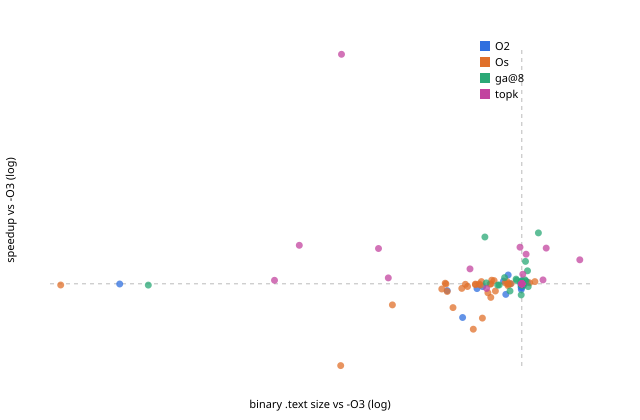

# Evaluation `final`: 33 held-out programs in 11 families

| method | geomean (95% CI) | excl. largest | >=3% | >=5% | regressions | size (geomean) | compiled | timed |
|---|---|---|---|---|---|---|---|---|
| O2 | -0.78% (-1.96..+0.08) | -0.93% | 1/33 | 0/33 | 5 | 0.907 | 1 | 0 |
| Os | -3.40% (-6.13..-1.11) | -3.55% | 0/33 | 0/33 | 9 | 0.760 | 1 | 0 |
| topk | +6.67% (+1.89..+14.62) | +3.41% | 9/33 | 8/33 | 0 | 0.877 | 78 | 8 |
| topk_nodyn | +6.25% (+1.65..+13.94) | +2.99% | 9/33 | 8/33 | 0 | 0.833 | 78 | 8 |
| ml_top1 | +1.14% (-4.96..+9.64) | -2.10% | 7/33 | 6/33 | 11 | 0.804 | 1 | 0 |
| random_topk | +1.39% (+0.20..+2.95) | +0.86% | 4/33 | 4/33 | 0 | 0.955 | 83 | 8 |
| ga@8 | +1.86% (+0.11..+4.26) | +1.18% | 4/33 | 4/33 | 1 | 0.931 | 53 | 10 |
| random@8 | +5.62% (+1.16..+13.19) | +2.50% | 10/33 | 6/33 | 0 | 0.912 | 50 | 10 |

A/A control in the final runs: worst 7.35%, median 0.46%.
Regressions = the method shipped a binary whose final 95% CI lies below -O3.

IR-count vs runtime over 18637 measured candidates: Spearman rho(log IR ratio, log speedup) = -0.080. Candidates with >1% fewer IR instructions than -O3: 38%, of which faster than -O3: 57%; median speedup 1.005x.

