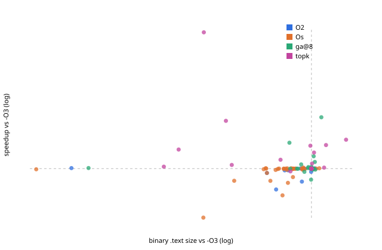

# Evaluation `final_serial`: 33 held-out programs in 11 families

| method | geomean (95% CI) | excl. largest | >=3% | >=5% | regressions | size (geomean) | compiled | timed |
|---|---|---|---|---|---|---|---|---|
| O2 | -1.01% (-2.28..-0.11) | -1.05% | 0/33 | 0/33 | 6 | 0.907 | 1 | 0 |
| Os | -3.01% (-5.67..-0.89) | -3.12% | 0/33 | 0/33 | 17 | 0.760 | 1 | 0 |
| topk | +7.51% (+2.25..+15.77) | +4.30% | 9/33 | 8/33 | 1 | 0.877 | 78 | 8 |
| topk_nodyn | +6.13% (+1.53..+13.67) | +2.93% | 8/33 | 8/33 | 2 | 0.833 | 78 | 8 |
| ml_top1 | +2.36% (-3.72..+10.85) | -0.85% | 7/33 | 6/33 | 16 | 0.804 | 1 | 0 |
| random_topk | +1.61% (+0.21..+3.35) | +1.10% | 4/33 | 4/33 | 0 | 0.955 | 83 | 8 |
| ga@8 | +2.08% (-0.09..+5.27) | +0.90% | 5/33 | 4/33 | 6 | 0.931 | 53 | 10 |
| random@8 | +5.28% (+0.79..+12.77) | +2.23% | 9/33 | 7/33 | 6 | 0.912 | 50 | 10 |

A/A control in the final runs: worst 2.24%, median 0.08%.
Regressions = the method shipped a binary whose final 95% CI lies below -O3.

IR-count vs runtime over 18637 measured candidates: Spearman rho(log IR ratio, log speedup) = -0.080. Candidates with >1% fewer IR instructions than -O3: 38%, of which faster than -O3: 57%; median speedup 1.005x.

