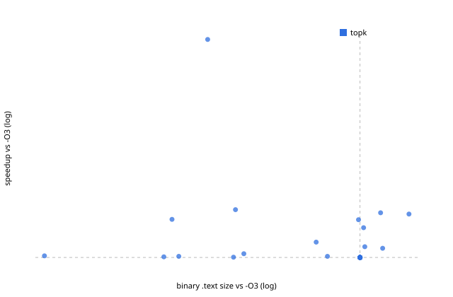

# Evaluation `rl`: 33 held-out programs in 11 families

| method | geomean (95% CI) | excl. largest | >=3% | >=5% | regressions | size (geomean) | compiled | timed |
|---|---|---|---|---|---|---|---|---|
| topk | +7.64% (+2.54..+15.73) | +4.40% | 10/33 | 9/33 | 0 | 0.789 | 78 | 8 |
| rl_topk | +3.31% (+1.14..+5.93) | +2.64% | 8/33 | 6/33 | 0 | 0.901 | 24 | 5 |
| rl_lib_topk | +7.68% (+2.49..+15.81) | +4.43% | 9/33 | 9/33 | 0 | 0.906 | 81 | 8 |

A/A control in the final runs: worst 2.55%, median 0.60%.
Regressions = the method shipped a binary whose final 95% CI lies below -O3.

IR-count vs runtime over 18637 measured candidates: Spearman rho(log IR ratio, log speedup) = -0.080. Candidates with >1% fewer IR instructions than -O3: 38%, of which faster than -O3: 57%; median speedup 1.005x.

