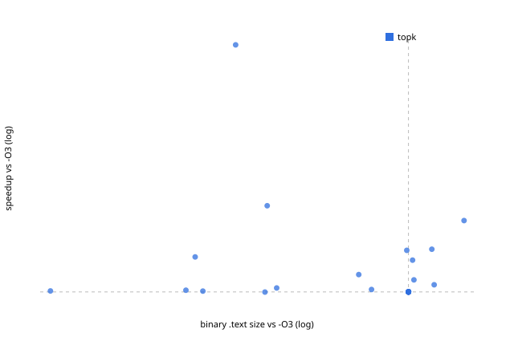

# Evaluation `rl_serial`: 33 held-out programs in 11 families

| method | geomean (95% CI) | excl. largest | >=3% | >=5% | regressions | size (geomean) | compiled | timed |
|---|---|---|---|---|---|---|---|---|
| topk | +7.92% (+2.57..+16.23) | +4.74% | 10/33 | 9/33 | 0 | 0.789 | 78 | 8 |
| rl_topk | +3.35% (+1.12..+6.19) | +2.51% | 8/33 | 6/33 | 0 | 0.901 | 24 | 5 |
| rl_lib_topk | +8.09% (+2.60..+16.35) | +4.92% | 9/33 | 9/33 | 0 | 0.906 | 81 | 8 |

A/A control in the final runs: worst 1.31%, median 0.09%.
Regressions = the method shipped a binary whose final 95% CI lies below -O3.

IR-count vs runtime over 18637 measured candidates: Spearman rho(log IR ratio, log speedup) = -0.080. Candidates with >1% fewer IR instructions than -O3: 38%, of which faster than -O3: 57%; median speedup 1.005x.

