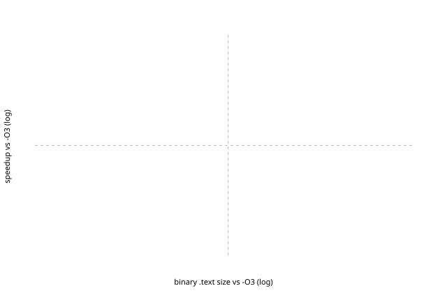

# Evaluation `predict_test_serial`: 33 held-out programs in 11 families

| method | geomean (95% CI) | excl. largest | >=3% | >=5% | regressions | size (geomean) | compiled | timed |
|---|---|---|---|---|---|---|---|---|
| predict | +0.64% (-0.16..+2.05) | +0.02% | 1/33 | 1/33 | 1 | 0.999 | 0 | 0 |
| predict_sl | +0.64% (-0.14..+2.05) | +0.03% | 1/33 | 1/33 | 1 | 0.999 | 0 | 0 |
| predict_ungated | -0.69% (-2.94..+1.44) | -1.34% | 2/33 | 2/33 | 8 | 0.929 | 0 | 0 |

A/A control in the final runs: worst 2.44%, median 0.16%.
Regressions = the method shipped a binary whose final 95% CI lies below -O3.

IR-count vs runtime: not enough data.

