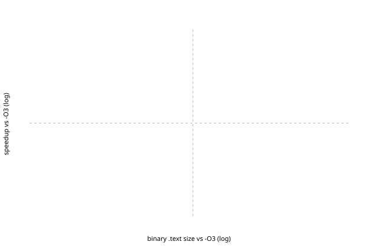

# Evaluation `predict_val_serial`: 22 held-out programs in 5 families

| method | geomean (95% CI) | excl. largest | >=3% | >=5% | regressions | size (geomean) | compiled | timed |
|---|---|---|---|---|---|---|---|---|
| predict | +0.00% (+0.00..+0.00) | +0.00% | 0/22 | 0/22 | 0 | 1.000 | 0 | 0 |
| predict_sl | +0.00% (+0.00..+0.00) | +0.00% | 0/22 | 0/22 | 0 | 1.000 | 0 | 0 |
| predict_ungated | -2.33% (-7.36..+0.41) | -2.54% | 0/22 | 0/22 | 2 | 1.015 | 0 | 0 |

A/A control in the final runs: worst 3.48%, median 0.24%.
Regressions = the method shipped a binary whose final 95% CI lies below -O3.

IR-count vs runtime: not enough data.

